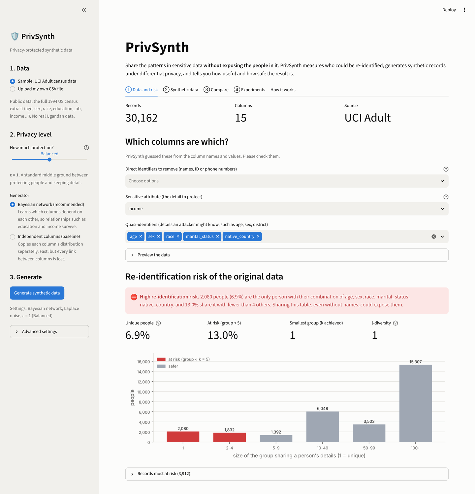
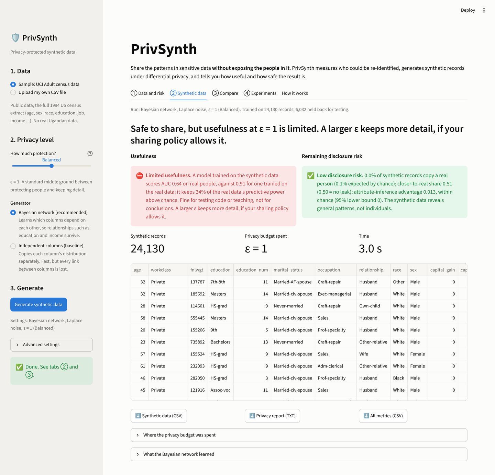
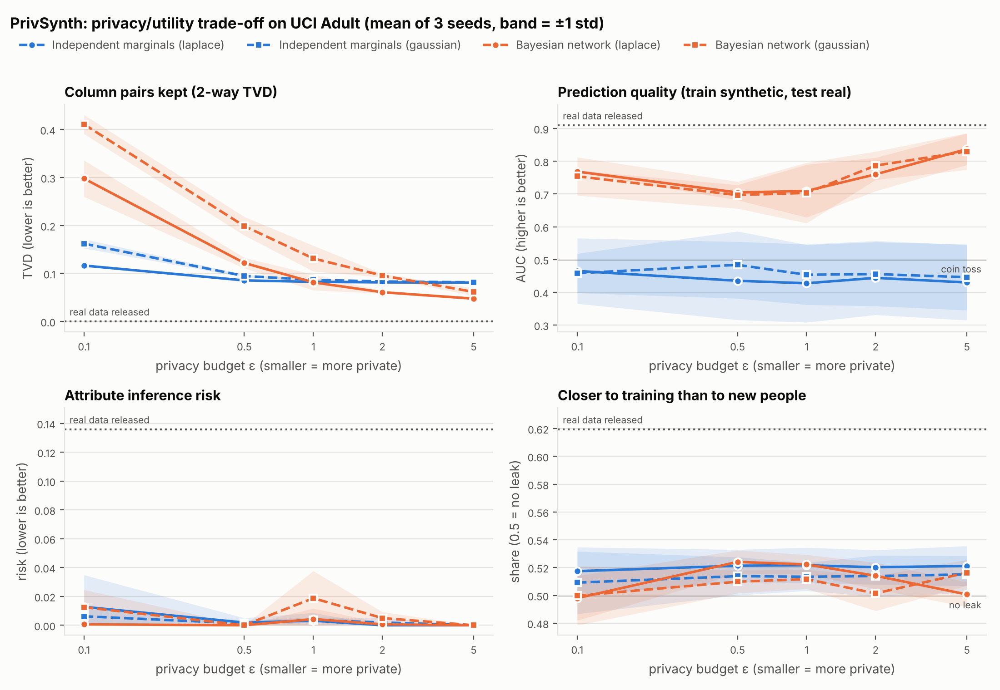

# PrivSynth

An object-oriented Python toolkit that generates privacy-protected synthetic data
and evaluates the balance between privacy and usefulness.

CSC8101 Object-Oriented Programming project — Christine Nakyejjwe (MSc Data Science and Analytics, Uganda Christian University).

## Project structure

```
privsynth/
├── privsynth/
│   ├── exceptions.py        # PrivSynthError and its subclasses
│   ├── data/
│   │   ├── dataset.py       # Dataset: a table + its privacy schema
│   │   └── loaders.py       # DataLoader (abstract), CSVLoader, AdultDataLoader
│   ├── privacy/
│   │   ├── risk.py          # Generalizer, KAnonymityChecker, RiskReport
│   │   ├── budget.py        # PrivacyBudget, BudgetEntry
│   │   └── mechanisms.py    # Laplace, Gaussian, Exponential mechanisms
│   ├── generation/
│   │   ├── encoding.py      # TableEncoder: values <-> integer codes
│   │   ├── base.py          # Synthesizer (abstract)
│   │   ├── marginal.py      # Generator 1: IndependentMarginalSynthesizer
│   │   └── bayesian.py      # Generator 2: BayesianNetworkSynthesizer
│   ├── evaluation/
│   │   ├── base.py          # Evaluator (abstract), EvaluationResult, shared helpers
│   │   ├── utility.py       # MarginalSimilarity, AssociationSimilarity, MachineLearningUtility
│   │   ├── disclosure.py    # DistanceToClosestRecord, AttributeInferenceRisk
│   │   └── suite.py         # EvaluationSuite, EvaluationReport, default_evaluators
│   ├── pipeline.py          # PrivSynthPipeline: split -> risk check -> generate -> evaluate
│   ├── experiments.py       # ExperimentRunner, ExperimentResults (tables, CSV, plots)
│   └── dashboard/
│       ├── sources.py       # DataSource (abstract), SampleDataSource, UploadedCSVSource, suggest_schema
│       ├── settings.py      # PrivacySettings, PRIVACY_LEVELS (plain-language presets)
│       ├── verdicts.py      # Verdict: metrics -> plain-language judgements
│       └── charts.py        # matplotlib figures used by the dashboard
├── app.py                   # Streamlit dashboard (screen layout only)
├── .streamlit/config.toml   # dashboard theme and upload limit
├── scripts/
│   ├── make_sample_data.py  # creates a small fake Adult-format file
│   ├── week1_demo.py        # risk check before/after generalisation
│   ├── week2_demo.py        # mechanisms, budget, generator comparison
│   ├── week3_experiments.py # privacy/utility experiments, tables and figures
│   └── make_demo_upload.py  # made-up survey CSV for trying the dashboard upload
├── results/                 # saved outputs of the demo and experiment scripts
├── docs/screenshots/        # dashboard screenshots
├── tests/                   # pytest test suite
├── data/                    # put adult.data here (not committed)
├── pyproject.toml
└── requirements.txt
```

## Setup

```bash
python -m venv .venv
source .venv/bin/activate          # Windows: .venv\Scripts\activate
pip install -e ".[dev]"
```

## Data

Experiments use the UCI Adult (Census Income) dataset [1]. Download
`adult.data` from https://archive.ics.uci.edu/dataset/2/adult and place it in
`data/`. Until then, `python scripts/make_sample_data.py` creates
`data/sample_adult.csv`, a randomly generated file in the same format
(no real people).

## Dashboard

```bash
streamlit run app.py
```

Your browser opens at http://localhost:8501. Then:

1. **Data**: use the sample Adult data or upload a CSV. PrivSynth suggests which
   columns are direct identifiers (removed), quasi-identifiers and the sensitive
   attribute; you can change them.
2. **Data and risk** tab: see how many people could be re-identified (k-anonymity).
3. **Privacy level**: choose from five named levels (ε = 0.1 to 5), the generator,
   and optionally the noise type, k and holdout share.
4. **Generate**: get a plain-language verdict on usefulness and remaining risk,
   preview and download the synthetic data, a privacy report and all metrics.
5. **Compare** tab: real vs synthetic distributions and relationships between columns.
6. **Experiments** tab: the Week 3 privacy/utility trade-off.

`data/demo_upload.csv` is a made-up survey (random names, phone numbers and Ugandan
districts; no real people) for trying the upload.




The verdicts use rules of thumb from the Week 3 experiments, not legal standards.
The attribute-inference verdict uses a 95% lower confidence bound, so sampling
noise on small files is not reported as a leak.

## Usage

```python
from privsynth import AdultDataLoader, Generalizer, KAnonymityChecker

dataset = AdultDataLoader().load("data/adult.data")
checker = KAnonymityChecker(k=5)
print(checker.evaluate(dataset))

coarser = Generalizer(bin_widths={"age": 10}, rare_threshold=50).generalize(dataset)
print(checker.evaluate(coarser))
```

Generate differentially private synthetic data:

```python
from privsynth import AdultDataLoader, BayesianNetworkSynthesizer

dataset = AdultDataLoader().load("data/adult.data")
synth = BayesianNetworkSynthesizer(epsilon=1.0, bin_edges=AdultDataLoader.BIN_EDGES, random_state=0)
synthetic = synth.fit_sample(dataset, n=5000)

print(synth.network)              # which column depends on which
print(synth.budget.summary())     # every epsilon spent, step by step
synthetic.data.to_csv("synthetic_adult.csv", index=False)
```

Swap in `IndependentMarginalSynthesizer` for the baseline, or pass
`noise="gaussian"` for Gaussian instead of Laplace noise.

Run the whole workflow (split, risk check, generate, evaluate) in one call:

```python
from privsynth import AdultDataLoader, PrivSynthPipeline

dataset = AdultDataLoader().load("data/adult.data")
pipeline = PrivSynthPipeline.from_settings("bayesian", epsilon=1.0,
                                           bin_edges=AdultDataLoader.BIN_EDGES, random_state=0)
result = pipeline.run(dataset)       # 80% train, 20% holdout
print(result)                        # original risk + utility + remaining risk
print(result.evaluation["ml"])       # one evaluator's metrics
```

Compare many privacy settings:

```python
from privsynth import ExperimentRunner

runner = ExperimentRunner(dataset, epsilons=[0.1, 1, 5], seeds=[0, 1, 2],
                          synthesizer_options={"bin_edges": AdultDataLoader.BIN_EDGES})
results = runner.run(progress=print)
print(results.summary(["ml.auc_synthetic", "inference.inference_risk"]))
results.plot("ml.auc_synthetic")
```

### What the evaluators measure

| Evaluator | Kind | Question | Headline metric |
|---|---|---|---|
| `MarginalSimilarity` | utility | Are single columns and column pairs distributed the same? | 1-way / 2-way TVD (0 = identical) |
| `AssociationSimilarity` | utility | Are relationships between columns as strong? | mean difference in Cramér's V |
| `MachineLearningUtility` | utility | Does a model trained on synthetic data predict real people well? | AUC, train synthetic / test real |
| `DistanceToClosestRecord` | risk | Are synthetic records near-copies of training records? | exact copies; share closer to train than to holdout (0.5 = no leak) |
| `AttributeInferenceRisk` | risk | Can an attacker who knows someone's quasi-identifiers guess their income? | member vs non-member attack advantage (0 = no leak) |

The risk evaluators compare **members** (training records) with **non-members**
(the holdout). An attack that works equally well on both only reveals general
patterns; one that works better on members is leaking individuals [5], [6].

Run the demos and the tests:

```bash
python scripts/week1_demo.py
python scripts/week2_demo.py      # about 40 s on the full Adult data
python scripts/week3_experiments.py   # about 3 min; writes results/ and results/figures/
streamlit run app.py
pytest                                # includes a headless run of the dashboard
```

## Week 3 results (UCI Adult, 24,130 train / 6,032 holdout, 3 seeds)



- **Releasing the real data is risky.** 7.6% of training records are unique on
  their quasi-identifiers; every released record is an exact copy, and the
  inference attack gains an advantage of 0.136 on the people in the data.
- **DP synthetic data removes that risk at every ε tested.** Across all 60
  runs (ε = 0.1 to 5): no exact copies, closer-to-train share 0.48–0.54
  (0.5 = no leak) and inference risk at most 0.04 (averages at most 0.02).
- **Generator 2 is far more useful.** A model trained on Bayesian-network data
  reaches AUC 0.84 on real people at ε = 5 (92% of the 0.91 from real data);
  the independent generator stays at chance (~0.45), because it breaks the link
  between income and everything else.
- **Laplace beats Gaussian here.** For the same ε, Gaussian noise gives higher
  2-way TVD (e.g. 0.13 vs 0.08 for generator 2 at ε = 1), since each table is
  released separately, where Laplace's lower noise for small releases wins.
- **Below ε ≈ 2, prediction quality depends on the learned structure.** The
  network gives `income` one parent; at ε = 5 every seed picks `relationship`,
  at ε ≤ 1 the private structure step often picks a weaker parent.

Full tables: `results/week3_results.txt`; every run: `results/week3_runs.csv`.

## Progress

- [x] Week 1 — data classes, k-anonymity risk checker, tests
- [x] Week 2 — Laplace/Gaussian/Exponential mechanisms, privacy budget, two generators
- [x] Week 3 — utility and risk evaluation, pipeline, experiments, tests
- [x] Week 4 — Streamlit dashboard, tests
- [ ] Final report

## References

[1] D. Dua and C. Graff, "UCI Machine Learning Repository," University of California, Irvine, 2019.
[2] C. Dwork and A. Roth, "The algorithmic foundations of differential privacy," *Found. Trends Theor. Comput. Sci.*, vol. 9, no. 3–4, pp. 211–407, 2014.
[3] B. Balle and Y.-X. Wang, "Improving the Gaussian mechanism for differential privacy: Analytical calibration and optimal denoising," in *Proc. ICML*, 2018, pp. 394–403.
[4] J. Zhang, G. Cormode, C. M. Procopiuc, D. Srivastava, and X. Xiao, "PrivBayes: Private data release via Bayesian networks," *ACM Trans. Database Syst.*, vol. 42, no. 4, pp. 1–41, 2017.
[5] M. Giomi, F. Boenisch, C. Wehmeyer, and B. Tasnádi, "A unified framework for quantifying privacy risk in synthetic data," *Proc. Privacy Enhancing Technol.*, vol. 2023, no. 2, pp. 312–328, 2023.
[6] T. Stadler, B. Oprisanu, and C. Troncoso, "Synthetic data – anonymisation groundhog day," in *Proc. 31st USENIX Security Symp.*, 2022, pp. 1451–1468.
